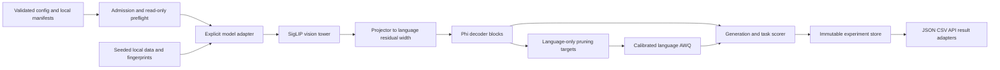

# Consolidated architecture review — Missions 3.6 / 3.7

The model, vision tower, projector, embeddings and LM head are separate regions.
Only the six recognized Phi block linears are current compression targets. Masks
preserve dimensions; physical MLP reduction must slice fc1 outputs and fc2 inputs
together. Vision/projector/head/embedding pruning is unsupported until its complete
interface is validated. There is no claim of generic architecture compatibility.

Review findings: legacy builders duplicate loading, dtype/device handling and LoRA
merging. The controlled dense evaluator is the supported baseline path; we retain
legacy paths rather than consolidate unknown real-checkpoint behavior. Stale UI
presentation components/static research data remain disconnected from the active
API app; they are not experimental evidence. Copied AWQ extension-dependent files
are not the portable execution path. Optional training imports remain isolated.
No broad vendor rewrite or speculative vision/head pruning is justified by CPU
fixtures. Source-level physical MLP dependencies are concrete; head/rotary/cache
reconstruction needs separate design and validation.

Tracking is local POSIX, single worker. Terminal state revisions are authoritative,
not an all-or-nothing multi-file transaction. PID reuse/orphan supervision remains
limited. Snapshot files are immutable by API convention, not an OS security boundary.
Loaders accept only explicit trust for pickle. GPU acknowledgement is separate from
environment detection and cannot verify financial authorization. No module provisions
infrastructure; unsupported third-party entry points are outside this local policy.

CPU review identified activation slicing/casting and training-mode restoration in
AWQ calibration as concrete Mission 5 work. Repeated full-model calibration forward
passes are a known performance cost, not an excuse to claim optimized kernels.
